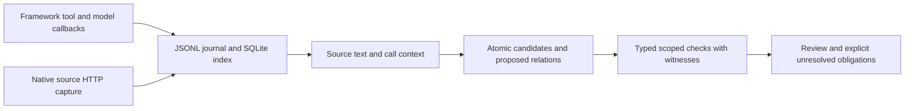

# Architecture and evidence boundaries

TrustKernel is a sidecar over recorded agent workflows. The pinned upstream runs analyst/research/trader/risk stages; an observer captures observable inputs, outputs, calls, usage and errors without private reasoning. Raw immutable recordings and rebuildable indexes remain separate from extracted candidates and assessments.

Historical extraction separates assertion occurrences from normalized candidate propositions. Exact raw/decoded pointers, Unicode spans, actor/call/run identity, source versions/clocks and exposure modes preserve provenance. Repository availability, backend retrieval, actual input content, prior-report propagation and citation are different facts. They do not establish private reliance or sufficient support.

The procedural loop is a deliberately authored fixture runtime: two raw shapes, explicit TTL/version schedule, dynamic host finding delivery/refresh/revision, checks and binding-specific clearance. It demonstrates mechanism rather than actual live-agent enforcement. The recorded-loop adapter uses actual original reports and source prefixes; its new reviewer receipts do not repair original agent obligations or fabricate a historical response. The live-source runtime observes native Yahoo/FRED/Polymarket routes and exact tool strings; HTTP metadata remains out-of-band. Its completed live_verification adapter builds a separate canonical ledger and scoped findings; the November4 run and its private-data boundary are summarized in docs/context/LATEST_RUN.md.

PASS/FAIL/INCONCLUSIVE/NOT_APPLICABLE/ERROR apply to named checks and prerequisites. Numeric equality, source integrity, temporal eligibility, required-tool compliance, source authority and decision suitability remain separate. No aggregate reasoning score, complete semantic recall, accepted causal dependency graph, private-reasoning access or investment suitability guarantee is claimed.

Frontend assets are draft inspection concepts, not the verification engine. Sponsor ideas are historical integration hypotheses, not dependencies or completed deployments. Third-party execution receipts cannot establish semantic truth by themselves.
